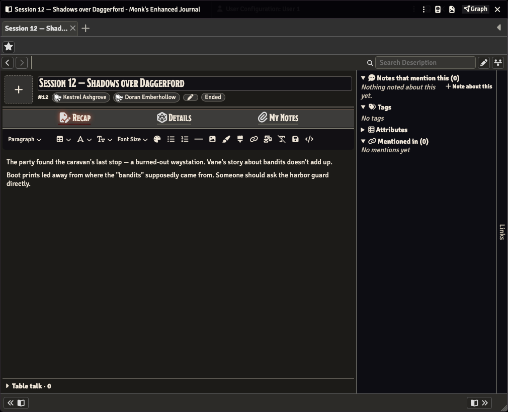
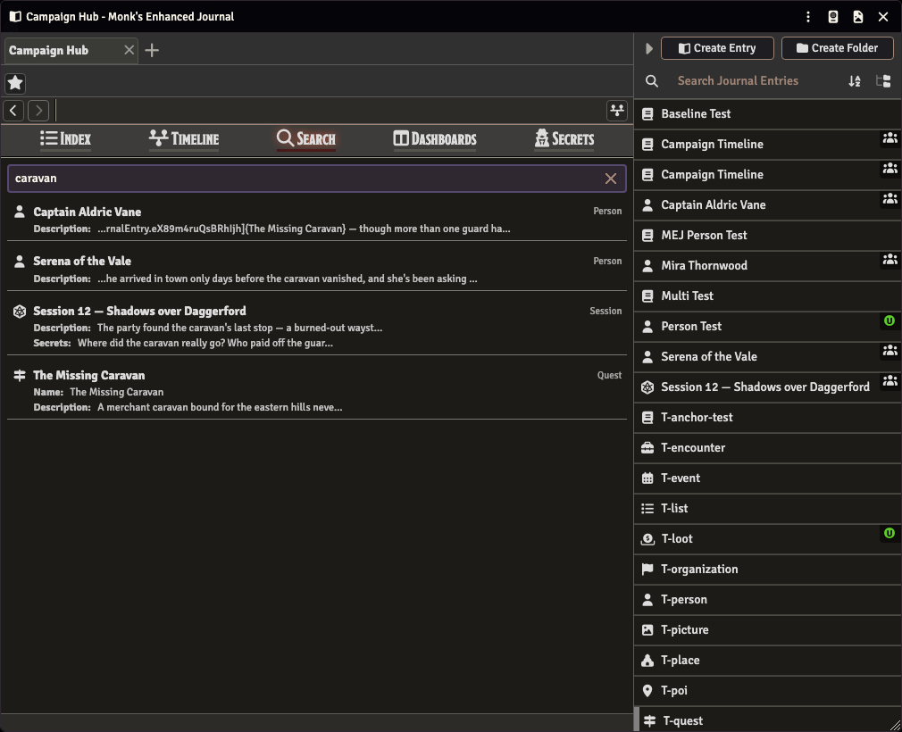
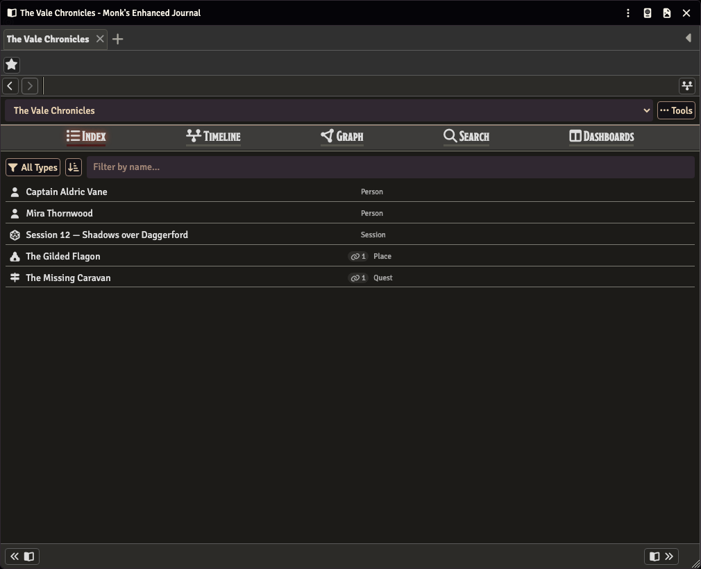
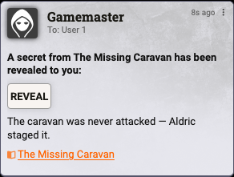
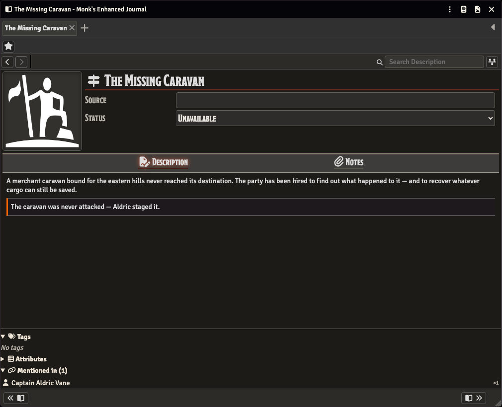

# Campaign Companion — Player Guide

If your GM runs their game with Monk's Enhanced Journal and a module called Campaign Companion, this guide covers what you'll actually see and do with it: reading and writing session recaps, finding the people and places your GM has written up, opening your campaign's portal, reading a relationship graph and a timeline, and seeing secrets as your character learns them. None of it changes how you play — it changes what you can look up and contribute to between sessions.

If you're running the game rather than playing in it, read the [GM guide](gm-guide.md) instead — this one is written from a player's seat.

## What Campaign Companion means for you

Your GM's world is organised into **campaigns** — a folder of entries plus a **portal entry** that opens straight into the module's home base, the **Campaign Hub**. Everything you can reach from your seat comes through one of three things: session pages, the Hub, and the entries your GM has shared with you.

The piece you'll interact with most directly is the **Session** page — one per game session, opened the same way as any other journal entry your GM shares with you. A header row sits above the tabs: the session's thumbnail (click it to see the image full size, on your screen only), its name, `#<number>`, the characters playing tonight as small chips, and a status chip that reads **Live** with the elapsed time while the session is running and **Ended** once it has finished. From a player's seat the page has three tabs: **Recap**, **Details** and **My Notes**, plus **Relationships** whenever you can add a party relationship there or have one to see (see [Recording relationships](#recording-relationships)).

The Recap tab holds one recap for the whole table — what happened, as the GM and the players write it together — and, under it, **Table talk**, the notes everyone jots down during play (see [Taking notes during play](#taking-notes-during-play)). The **Details** tab shows the session number, its in-game date and any secrets already revealed to you.

## Reading session pages & writing your recap

Your GM will let you know how to find a session page — usually by sharing it directly in Foundry, or by pointing you to it in the Hub's index (more on that below). If you own the entry, there is nothing to open or save: click into the recap and type what your character remembers, noticed, or wants to flag for next time. The formatting toolbar appears while your cursor is in the recap:

Your text saves by itself. A small line beside the recap reads "Saving…", "Saved" or "Couldn't save"; it saves when you click away, switch tabs or close the sheet, and periodically while you type. If someone else has the recap open at the same time you'll see their typing appear as they go — you're editing one document together, not two copies, and notes arriving from the table never interrupt what you are typing. Click out of the recap before dropping or pasting an image onto it — while your cursor is in it, the drop is refused with a notice. If you mention another entry by name, it may become a link when you save — that's auto-linking, and it only touches text you just added.

If you can't type in the recap, you don't own that session — the **Players Write Sessions** setting and per-entry ownership are both the GM's to set, so ask them. You can still read the recap, and it refreshes on your screen when someone else saves it.

**My Notes** is a private notepad on the same page. It starts with "These notes can only be seen by you.", is always editable and saves by itself. If you own the session page, your notes save straight to it. If you can only view the page, saving goes through the GM: with no GM connected it reads "Can't save until a GM connects", and what you typed is kept in your browser (it is still there after a reload) and saved automatically as soon as a GM connects. If a save fails it reads "Couldn't save" and is tried again; text that couldn't be saved stays on this browser until it is.

**Who's playing.** The chips in the header show which characters are at the table tonight. If you can manage attendees, the **+ Attendees** control opens **Who's playing tonight?**, a checklist of the campaign's player characters; you can also drag an Actor onto the header.

## Taking notes during play

Notes are short lines you jot down while the game runs: a name you heard, a clue, a promise. Each note is signed with your name, stamped with the time and the in-world date, and filed under the session in progress.

- **Where to write:** the capture box on the Hub's Tonight strip, the **Table talk** drawer on the Session page's Recap tab, or **Note about this** on an entry (the entry is filled in for you). In chat, type `/note your text` (or `/n`) from anywhere.
- **No session running:** the strip says "No session running". You can still write; your notes wait and join the next session your GM starts.
- **Your notes are yours:** they are always signed as you. You can edit or delete your own notes (an edited one shows "edited"), and so can your GM; nobody else can.
- **Plain text:** whatever you type stays as typed. Typed link codes are not turned into links; the Companion may link entry names it recognises, but only to entries everyone who reads the notes can see.
- **Notes that mention this:** notes that mention an entry show under **Notes that mention this** in its Links rail, each starting with its session's name as a link. **Note about this** is missing on entries not everyone can see.
- **Sessions tab:** each session shows how many notes it holds, and while a session is open, the Hub opens on Sessions if it has no tab remembered for you.
- **Timeline:** notes with an in-world date appear on the timeline in date order when **Show party notes** is on.

Table talk lines that record a shared image or a revealed secret link to it: click the image's name to open it on your screen only, or the entry's name to open the entry. You only ever see a link on a note you could already see. Notes are not canon. They are the table's scratch paper; the GM decides what goes into the recap with **add to recap**.

## If your GM has made you a contributor

Some GMs turn on the **Contributors** setting for a campaign — on their side, from the Hub's campaign settings — and list you there, alone or as part of a player group. If they have, selecting a run of plain text (up to 80 characters, no line breaks) on one of that campaign's pages and right-clicking it shows a **Create entry from selection** item in the context menu, the same one your GM sees, alongside MEJ's own Extract to Journal Entry. Pick a type, adjust the name if you want, and click **Create**: the companion makes the new entry, links the text you selected to it, and — if you leave **Link other mentions** checked — offers up every other plain-text mention of that name to your GM's own Retroactive Auto-Link setting. If the text you selected is already the name of an entry you can see in that campaign, the item reads **Link to entry** instead, and choosing it links your selection to that entry rather than making a new one (a picker asks which, if several share the name).

Your request goes through an active GM's client, so it only works while a GM is connected — with none online the menu item isn't there at all. The entry that comes back has exactly the ownership a GM creating it in that campaign would give it — the campaign's **Player access** baseline — so who can see it follows that baseline, not the fact that you asked for it. If the baseline lets players see the campaign's entries, you (and the rest of the table) can see the new one like anything else your GM writes there, and it opens as a background tab next to the page you were on in the journal window. If the baseline is **GM only**, the entry is still created and your selection still becomes a link to it, but you won't get a tab for it and neither you nor the other players can open it until your GM shares it.

## Finding things

Once your campaign has more than a few sessions, you won't always remember which entry mentioned what. The **Campaign Hub** is the home base for the whole campaign, and it's open to you as well as to your GM. There are three ways in, and all of them work from a player's seat:

- the **Campaign Hub** button in MEJ's own shell navigation;
- the **Campaign Hub** tool in the **Journal Notes** group of Foundry's scene controls;
- opening a campaign's portal entry from the journal sidebar — see [The campaign portal](#the-campaign-portal) below.

Campaign folders show a flag icon in the sidebar; everything inside one belongs to that campaign.

A **header bar** runs across the top of the Hub. If you can see only one campaign, it shows that campaign's name; otherwise it holds a **campaign picker**, and it always holds a **Tools** button. The picker scopes every pane below it — it offers **All campaigns** and each campaign you're allowed to see — no Unfiled entry and no option for creating a campaign, which are GM-only. **Tools** holds a single item for you, **Open the full user guide**, which opens this document in a new browser tab. Your GM's header bar has more on it: a settings gear and a **New session** button that aren't rendered for you.

Below the header bar are the panes. **You see five** — **Sessions**, **Entries**, **Timeline**, **Graph** and **Search** — plus **Dashboards** when your GM has shared one. **Sessions** lists every session you can see, newest first, with who was there and the first line of its recap. Beside the tabs, the **Help** (?) button opens a short in-Hub summary; the full guide is linked from inside it, and **Tools** still has **Open the full user guide**. Your GM sees one more pane, **Secrets**, which isn't rendered for a non-GM at all.

The **Entries** pane (the index) lists every campaign-relevant entry you can see: each of your GM's typed entries (Person, Place, Quest, Shop, and so on) plus Session pages. Its toolbar gives you a type filter (labelled **All types** until you check something, and built from the types actually present rather than a fixed list), a sort button offering **Name** or **Type**, and a **Filter by name…** box with a count beside it once you type. Each row shows a type glyph, the name, a mention-count badge where other entries link to it, the type, and the campaign it's filed into. Your GM's rows also carry hide and file buttons; yours carry none.

The **Search** pane is faster than scrolling the index once you know roughly what you're after. Its box is placeholdered **Search everything…**; type at least two characters and results appear as you type, each row naming the field the match landed in:

(That shot was taken from the GM's own seat — you can tell by the seven tabs and the **New session** button. It includes a **Secrets:** match line under Session 12 that a player's results would never turn up. Your own search only ever reaches what your permissions allow, the same rule that governs everything else in this guide.) Where a match falls inside a link, the snippet shows the link's text (for example "the Duke"), not its markup.

Your GM's typed entries — Persons, Places, Quests and the rest — also carry a **Links** rail on the right of the sheet (closed, it is a folder-style tab reading **Links (N)**), and its **Mentioned in (N)** section lists which other entries link to it with a ×N count each — handy for tracing how two people or places you've heard of connect. It sits alongside **Tags** and **Attributes** in the same rail; from your seat all three are read-only, and an entry with no tags reads "No tags".

The **Dashboards** pane holds saved searches your GM has built. You'll see the ones they marked **Visible to players**, with their live results listed underneath — a ready-made search, filtered the same way as everything else. There are no controls on it from your seat, and an empty pane reads "No dashboards yet."

## The campaign portal

Every campaign has a **portal entry** — an ordinary-looking journal entry in your sidebar, named after the campaign. If your GM has given the campaign player access, it shows up for you like any other entry. Opening it doesn't show a page of text: it mounts the Campaign Hub, already scoped to that campaign, with the window title and the shell's tab both reading the campaign's name.

That makes the portal the easiest thing to bookmark: one click and you're in the Hub looking at just that campaign, with everything you're not allowed to see already stripped out. In the shot above the index holds the five entries this player can reach — two Persons, a Session, a Place and a Quest — and the rows carry no hide or file buttons, because those are your GM's.

## The relationship graph

The Hub's **Graph** pane is a visual map of how people, places and other entries connect, built from the relationships your GM has drawn between them. It's a tab of its own, sitting between Timeline and Search — there's no graph button on an entry sheet's window header.

Five controls sit above the canvas, and they're identical to your GM's:

- **Whole campaign** lays out everything in the current scope at once. It's the mode you land in.
- **Focus** centres on one entry and shows only its direct connections. Click a node, or pick an entry from the **Focus on…** list beside it, to choose which entry to centre on; it stays unavailable until one is chosen.
- **Focus on…**, a picker, lists the entries you can see so you can centre the graph on any of them without hunting for its node.
- **Show mention links**, a checkbox, layers plain `@UUID` mentions on top of the relationship lines. It's off by default.
- **Show party relationships**, a checkbox, draws party relationships as dotted lines.

Clicking a node focuses the graph on it; double-click it (or Ctrl/Cmd-click) to open its entry.

Each node draws the entry's own picture inside a type-coloured ring — the two Persons above carry portraits their GM gave them, while the Quest and the Place fall back to a type icon and the Session node is a plain coloured disc with no image. (Entries rows never show the portrait; they always draw the glyph.)

Don't be surprised if your graph looks sparser than what your GM sees on their own screen. You'll see every entry that's relevant to you, but a line only appears between two of them once that specific relationship has been made visible to you. A node sitting there with no lines — "Session 12 — Shadows over Daggerford" above — just means the graph knows about it, but not (yet) how it connects to anything else from where you're standing.

When your GM does reveal a relationship to you, it turns up in two places: as a new line on the graph, and on the entry's own **Relationships** list, where a connection that had been hidden from you appears as a fresh row (or, if it can't be slotted into the existing list, under a heading of its own reading "Known connections"). A relationship that was already visible but carried a hidden note gets that note added inline instead, marked with an eye icon.

One thing to expect on a big campaign: the graph draws at most 200 entries at a time. Past that it shows the notice "Too many entries to draw — filter to reduce (showing the most-connected 200)." and keeps the most-connected ones — narrow the campaign picker's scope if you hit it.

## Recording relationships

You can note what the party thinks ties two entries together ("Sister of", "Owes money to", "Saw them at the docks") without waiting for your GM to draw it. These are **party relationships**: the party's shared beliefs, kept beside your GM's own relationships and never overwriting them. You can add them if your GM has made you one of the campaign's **Contributors**.

Open an entry and go to its **Relationships** tab. Your GM's relationships are listed as usual. To add one of your own, either:

- drag a journal entry from the sidebar onto the list, or
- click **Add relationship** at the foot of the list, type in the search box, and pick the entry.

If you own the entry you're on, dropping another entry onto its list makes a regular relationship, the same kind your GM makes, rather than a party one. **Add relationship** always adds a party relationship.

A new line appears with an empty label and the cursor in it. Type how this entry relates to the other one; it saves as you type. Nothing else is required, and the label can stay empty.

- There is **one party relationship per pair** of entries, and each side has its own label, like Monk's Enhanced Journal's reciprocal rows: what you type on Ilva's page shows on Ilva's page; Mara's page has its own label for the same pair. Adding a pair that already exists just takes you to its line.
- Where your GM already has a relationship between the two entries, the party's label sits on the same line, just under the GM's.
- **Any Contributor can edit or delete** any party relationship. Each line shows who edited it last ("edited by Jo"). The bin removes the pair from both entries; adding it again is the way back.
- **No GM needs to be online.** Your edits save straight away. (In a campaign your GM hasn't opened since updating, you may see "A GM must open the world once before party relationships can be added in this campaign.")
- Players who aren't Contributors see the party's labels but can't change them.

Party relationships also show on the Hub's **Graph** as dotted lines (untick **Show party relationships** to hide them). If your GM turns off **Players can add party relationships**, existing ones stay visible but read-only.

## When secrets are revealed to you

Some entries in your GM's campaign hold secrets — things your character doesn't know yet. Until one is revealed to you it isn't merely hidden: secrets you aren't cleared for are stripped out of the page before it's drawn, so they never reach your screen at all. There's also no Secrets tab in your Hub; that pane is GM-only.

When your GM reveals one, you get a private whisper in your chat log naming which entry the secret came from, with its text and a link straight back to the entry:

From then on the secret is also on the entry's own page. What it looks like there depends on how your GM revealed it:

- **Revealed to you, or to a group you're in** — the block carries Campaign Companion's own marker, an orange rule down its left edge, so you can tell at a glance which part of the page you've only just been let in on:

- **Revealed to everyone** — the block is marked with Foundry's *own* reveal rather than the module's, so it reads as ordinary page text with no orange rule. The upside is that it holds up outside the module: it stays revealed on core journal sheets and in a player-safe Word export. Core Foundry draws a small **Hide** control on blocks like these, but you won't see it: Campaign Companion removes it for anyone who can't edit the entry, so a stray click of yours can't rewrite your GM's page. Only your GM (or another owner of that entry) gets that control.

The same applies to secrets your GM tucked into a session recap rather than an entry description: once one is revealed to you, it appears in the recap on your own copy of the session sheet, with the same orange marker.

If you're curious how your GM manages reveals behind the scenes, that's covered in the [GM guide's secrets section](gm-guide.md#secrets) — though it's worth asking your GM directly, since it's their call how and when things get revealed.

## The campaign timeline

The Hub's **Timeline** pane lays out your campaign's key moments in order — a running record your GM builds up as the story goes, sometimes tied to an in-world date, sometimes not:

(That shot is from the GM's seat. **+ Add timepoint** at the bottom isn't rendered for you, and the pen and trash on each row are your GM's editing controls. What you get is the same timeline, read-only: the labels, the order, and anything attached to each point.)

The pane leads with a **timeline picker**, because a world can hold more than one. Its options are **All timelines in scope** (where it starts), a greyed-out **— World timelines —** separator, and then the timelines themselves; a **★** before a name marks the campaign's default. Your GM's picker also has a **➕ New timeline…** option and rename/delete controls beside it — yours has neither.

Three buttons below the picker change how the list is ordered, and all three work from your seat: **Manual** (the order your GM arranged them in), **Date Added** (when each one was created), and **Campaign Date** (the in-world date, for the timepoints that have one). A timepoint can also carry an attached entry, shown as a chip on its row — "The Caravan Departs" above links straight through to The Missing Caravan.

Attachments follow the same permission rule as everything else, with one extra twist. A linked entry only shows on your row if you're allowed to open it. An attached *image* is stricter still: it stays off a player's timeline entirely unless your GM has explicitly ticked it as shown to players, so a picture your GM has staged for a later reveal won't appear on your row before then.

Two empty states are worth recognising: a timeline that exists but holds nothing reads "No timepoints yet.", while a scope with no timeline at all reads "No timeline in this scope."

## Quick answers

**Why can't I see X?** Almost everything in Campaign Companion — index rows, search results, graph nodes and edges — filters to what your Foundry permissions allow. If something's missing, it's not a bug; it just hasn't been shared with you yet.

**Why didn't my name get linked?** When your GM types a name and it turns into a clickable link automatically, that only happens when every reader of that page would also be allowed to see what it links to. If a link would point somewhere you or another reader of that page can't see, it's left as plain text instead.

**Where's the Secrets tab?** There isn't one for you. The Hub renders five panes for a player (six when a GM shares a dashboard) and seven for a GM; **Secrets** is the GM's own tracker for everything they've hidden and everything they've revealed.

**Can the GM read my recap?** Yes — there is one recap per session and everyone at the table, GM included, reads and (if they own the entry) edits the same text. Treat it as public.

**What does a link look like in a search snippet?** A link inside a matched sentence shows just its text (for example "the Duke"), not the underlying link markup.
